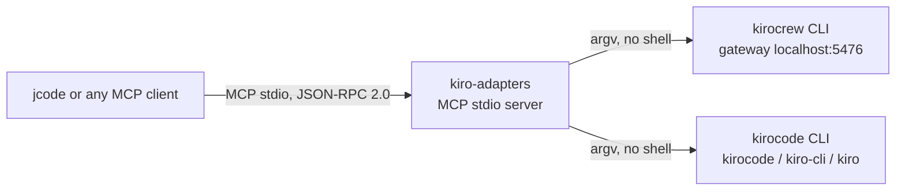
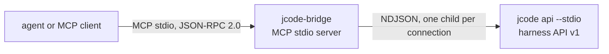

# kiro-adapters

Harness adapters that let jcode, or any MCP client, dispatch work to the two
Kiro side agent runtimes. `kiro-adapters` wraps the `kirocrew` personal agent
and the Kiro coding CLI behind one small, stable contract: every action
returns a single JSON object with the same ten keys and one of six result
codes, so a client can tell "not installed" apart from "not ready yet" apart
from "the agent answered" without parsing stderr. The package has no runtime
dependencies, the MCP server is standard library only, and every child process
is launched from an argument list, never through a shell.

## The two adapters

| Adapter | Harness | Status on this machine |
|---|---|---|
| `KiroCrewAdapter` | `kirocrew` | Installed, gateway reachable. |
| `KiroCodeAdapter` | `kirocode` | Not installed. |

`KiroCrewAdapter` drives the Kiro Crew personal agent, through the
`kirocrew` CLI and its local gateway. On this machine that is
`kirocrew 0.11.0-nightly.20261021t201456`, the gateway on
`http://localhost:5476`, and 14 agent definitions in `~/.kiro/agents/`.
Model calls need the KAS engine bundle, which is not installed.

`KiroCodeAdapter` drives the Kiro coding CLI, resolved as `kirocode`,
`kiro-cli` or `kiro`. The adapter resolves whichever binary exists and
probes its own `--help` for a non-interactive flag.

Both adapters return the same envelope, defined in
`src/kiro_adapters/result.py` and specified in `docs/ADAPTER-CONTRACT.md`.

## Architecture



The MCP server reads one JSON object per line from stdin and writes one per
line to stdout. stdout carries protocol frames only, every diagnostic goes to
stderr.

## Install

The package requires Python 3.9 or newer and pulls in no dependencies.

Editable install, which also puts the `kiro-adapter` and `kiro-adapter-mcp`
console scripts on your `PATH`:

```bash
cd /Users/kooshapari/CodeProjects/Phenotype/repos/kiro-adapters
python3 -m pip install -e .
```

Or run straight from the source tree with no install at all:

```bash
export PYTHONPATH=/Users/kooshapari/CodeProjects/Phenotype/repos/kiro-adapters/src
```

## Quickstart, from the shell

The CLI mirrors the MCP tools. It exits 0 when the result is ok and 1 when it
is not, and `--json` prints the whole result envelope.

```bash
# What is installed and is it ready
kiro-adapter status
kiro-adapter kas
kiro-adapter agents

# One chat turn with the Kiro Crew agent
kiro-adapter ask "summarise the README of this repository"

# Dispatch a background subagent, then list what is running
kiro-adapter spawn "investigate the failing test" --async
kiro-adapter spawn-list

# Run an autonomous task from a spec file
kiro-adapter run-spec TASK.md --name my-task

# The dashboard URL, with the access token redacted
kiro-adapter dashboard --ttl 30m

# The Kiro coding CLI
kiro-adapter kirocode-status

# The full result envelope, for scripting
kiro-adapter status --json
```

Without an install, prefix with `PYTHONPATH=src python3 -m kiro_adapters.cli`.

## Quickstart, as an MCP server

Register the server with an MCP client. A jcode-style `mcp.json`:

```json
{
  "servers": {
    "kiro": {
      "command": "/Users/kooshapari/.local/bin/kiro-adapter-mcp",
      "args": []
    }
  }
}
```

If you did not install the package, run the module directly instead:

```json
{
  "servers": {
    "kiro": {
      "command": "/opt/homebrew/bin/python3.12",
      "args": ["-m", "kiro_adapters.mcp_server"],
      "env": {
        "PYTHONPATH": "/Users/kooshapari/CodeProjects/Phenotype/repos/kiro-adapters/src"
      }
    }
  }
}
```

To confirm the server answers before wiring it into a client:

```bash
kiro-adapter-mcp --selftest
```

That prints the `tools/list` payload as JSON and exits.

The server exposes fourteen tools: `kirocrew_status`, `kirocrew_agents`,
`kirocrew_ask`, `kirocrew_spawn`, `kirocrew_spawn_list`,
`kirocrew_run_spec`, `kirocrew_dashboard_url`, `kirocode_status`,
`kirocode_ask`, and `kiro_dispatch`, which routes one prompt to either
harness. Alongside those ten are four read-only inventory tools:
`agent_sessions_list` and `agent_session_get` to enumerate and inspect
the agent sessions discovered on this host, `agent_session_history` for
one session's recorded transcript, and `agent_sources` to list which
harness data directories the inventory reads. The inventory tools never
start, resume, or close a session. Parameter names and result codes are
in `docs/ADAPTER-CONTRACT.md`.

## The jcode harness-API bridge

The `jcode_bridge` package points the same idea the other way: instead of Kiro
being a tool jcode calls, jcode becomes a session another agent can drive.
`jcode api --stdio` is a child process speaking newline-delimited JSON, so the
caller keeps a *session* rather than a process: text streams as it arrives, tool
calls and token usage are visible, and more than one turn can be sent before
disconnecting. Details, protocol frames, and payload keys are in
[docs/JCODE-API.md](docs/JCODE-API.md).



CLI, where `--json` is a global flag and precedes the subcommand:

```bash
jcode-bridge --json api-health          # handshake and ping, no session
jcode-bridge api-ask "list the tests" --cwd . --timeout 120
jcode-bridge --json api-ask "step one" --keep-session
jcode-bridge api-sessions --limit 10
```

MCP tools on the `jcode-bridge` server: `jcode_api_health`, `jcode_api_ask`
(`prompt` required; `cwd`, `timeout_secs`, `keep_session`) and
`jcode_api_sessions` (`limit`, `timeout_secs`), alongside the task-backend
tools `jcode_health`, `jcode_run`, `jcode_task_start`, `jcode_task_status`,
`jcode_task_output`, `jcode_task_cancel` and `jcode_task_list`.

One protocol detail is easy to get wrong and is worth stating here:
`send_message` is a **notify**, not a request. The daemon does not reply to it;
waiting for a reply blocks until the turn times out. The daemon acknowledges
indirectly with a `message_accepted` event once the agent has the message
queued, and the bridge treats that event as the acknowledgement.

### jcode as Kiro Crew's own backend

Kiro Crew's `agent.acp_backend` is a **closed enum**, so there is no config
value that names jcode. The enum is not the only lever, though: each backend
slot resolves the ACP binary it launches through an operator override, and the
`codex` slot's own gate (`SESSION_CONFIG` routing) accepts a harness that
advertises a `mode` config option and enforces `mode=read-only`. jcode's ACP
now does exactly that, so the slot is filled by a real restriction rather
than by a claim.

```bash
CODEX_ACP_BIN=~/bin/jcode-acp-shim kirocrew run TASK.md
```

`~/bin/jcode-acp-shim` execs `jcode acp`. The agent Kiro Crew spawns is jcode
and reports `agentInfo.name` as `jcode`; the `codex` in the logs is the slot
Kiro Crew was told to use, not the agent's identity.

The override is exported from `~/.zshrc` and points at a **versioned** jcode
build (`~/.jcode/builds/versions/0.99.1-kcode-mode/jcode`), so a Kiro session
started from a login shell uses jcode with no per-command configuration, and a
rebuild cannot leave the shim pointing at nothing.

The boundary worth stating: `read-only` is the only mode, so a Kiro session
running on jcode through this slot **cannot write**. Every write-capable tool
is disabled in the session's tool set, so it is not offered to the model at
all.

This is separate from the bridge above. The bridge is jcode calling *into*
Kiro Crew; this is Kiro Crew running *on* jcode.

## Verification status

Be precise about what has and has not been exercised.

| Surface | Status |
|---|---|
| `kirocrew` command surface | Verified against `kirocrew 0.11.0-nightly.20261021t201456`. |
| `kirocrew` gateway | Running on loopback, `http://localhost:5476`. |
| `kirocrew` status probe | Exercised. Returned `ok`, `gateway_running: true`, `token_auth: true`, `agents_available: 14`, `kas.installed: false`, `ready: false`. |
| `kirocrew` live agent turn | Not exercised. The KAS engine bundle is not installed, so `ask`, `spawn` and `run_spec` return `BLOCKED`. |
| `kirocrew` CLI startup latency | 12s to 46s observed. The adapter short timeout is 30s, so a cold probe can return `TIMEOUT`. |
| `kirocode` command surface | Implemented, not verified. No `kirocode`, `kiro-cli` or `kiro` binary was present on 2026-10-27. |
| MCP server | Implemented. JSON-RPC 2.0 over stdio, protocol `2024-11-05`, ten tools advertised. |
| CLI | Implemented. Subcommands mirror the MCP tools and return the same envelope. |
| `jcode api --stdio` handshake | Verified 2026-10-28 against `jcode 0.99.1`. `api-health` returned `OK`, `detail: "jcode-harness-api-bridge/0.1.0 (1)"`, negotiated version 1, `ping: true`. |
| `jcode` harness-API turn | Verified 2026-10-28. `api-ask` returned `OK` with `BRIDGE_OK` and `JSON_OK`: `message_accepted`, ordered `text_delta`s, `turn_done`, `answer` and `answer_chars` in the envelope. |
| `jcode_api_sessions` | Exercised 2026-10-28. The released daemon ignores `limit`, so the bridge bounds the list client-side. |
| MCP server, `jcode-bridge` | Implemented. Advertises the three `jcode_api_*` tools plus the seven task-backend tools; covered by `tests/test_jcode_bridge_wiring.py`. |
| Kiro Crew as a client of jcode | Verified 2026-10-28. A Kiro Crew agent invoked `@jcode-bridge/jcode_api_ask` and received `KIRO_BRIDGE_OK`; the call is an auto-approved tool invocation in `~/.kiro/crew/security_events.jsonl`. |
| Kiro Crew running ON jcode | Verified 2026-10-29. Two Kiro Crew sessions with `CODEX_ACP_BIN=~/bin/jcode-acp-shim` answered `JCODE_BACKEND_OK`; the ledger records `governance_decision / agent_backend:codex / allowed`. |
| Read-only enforcement | Verified 2026-10-29 at the daemon level: with `write`, `edit` and `bash` disabled they are absent from the session's tool set while `read` remains. |
| Test suite | `PYTHONPATH=src python3 -m unittest discover -s tests` reports `Ran 272 tests`, `OK`, on 2026-10-28. |

The `kirocrew` flags the adapter passes were each checked against the live
`--help` output of `chat`, `spawn`, `run`, `token`, `status` and
`kas status`. The live agent turn and the Kiro coding CLI remain unverified,
so treat those rows as untested code paths rather than proven behaviour.

## Security notes

- The `kirocrew` dashboard URL carries a signed JWT. It is redacted by
  default, and the MCP tool surface never exposes the raw value.
- The adapter never invokes a shell. Prompts are argument list entries, so a
  prompt containing shell metacharacters is still just a prompt.
- `PYTHONPATH` and `PYTHONHOME` are scrubbed from child process environments.
- Captured output is truncated at 20,000 characters.

## Links

- [Adapter contract](docs/ADAPTER-CONTRACT.md): tool schemas, result codes,
  readiness gates, redaction rules, and how to add a third harness.
- [jcode harness API](docs/JCODE-API.md): daemon protocol frames, CLI
  subcommands, MCP tools, payload keys, verification status, and why jcode
  cannot be Kiro Crew's ACP backend.
- [Operations runbook](docs/OPERATIONS.md): readiness checks, remediation for
  every failure code, kirocode argv profiles, troubleshooting table.
- [Model Context Protocol](https://modelcontextprotocol.io)
- [jcode](https://github.com/1jehuang/jcode)
- [Kiro Crew](https://crew.kiro.dev), the source of the `kirocrew` launcher.
- KAS engine manifest base, `https://kas.crew.kiro.dev`, as reported by
  `kirocrew kas status`.
