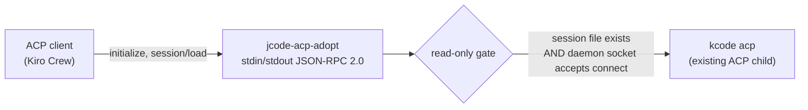

# ACP Adoption Shim

`jcode_bridge.acp_shim` lets an ACP client — Kiro Crew, or anything else that
speaks Agent Client Protocol — attach to a jcode/KCode session that the
operator is already running.

It is an **adopter**, not a launcher. The distinction is the whole point of
this module.

## What it does



1. Speaks ACP on newline-delimited JSON-RPC 2.0 over stdin/stdout. That is the
   framing the fork's ACP front end uses (`src/cli/acp.rs:316-322`), so the
   shim speaks to `kcode acp` without a translation layer.
2. Forwards `session/load` upstream, but only after two read-only checks pass.
3. Advertises `loadSession: true` and a single `read-only` mode.

## What it refuses to do

| Refused | Why |
|---|---|
| Start a daemon | `session/load` upstream calls `connect_daemon` → `ensure_daemon`, which *spawns* a daemon when none is running (`src/cli/acp.rs:851-867`). The shim checks for a live socket first and fails closed with `SHIM_PRECONDITION_FAILED` instead. |
| `session/new` | The shim adopts; it does not create. Blocked at the transport, not by policy. |
| `session/close` | Upstream, `session/close` cancels a running prompt and stops the event pump (`src/cli/acp.rs:653-677`). It is not a detach. Detach is dropping the connection. |
| Write-capable `session/set_mode` | The shim advertises `read-only` and nothing else. Selecting any other mode is refused locally. |
| Write config options | Anything named `write`, `writes`, `allow_writes`, `approval` or `auto_approve` is refused. |

`sessionCapabilities.close` is **dropped** from the advertised capabilities.
The shim must not advertise what it will not do.

## The adoption gate

`gate.assess` is the fail-closed gate. It runs two probes and both must pass:

1. **Session exists.** The session id must resolve to an existing `<id>.json`
   under a known session directory (`~/.jcode/sessions`, `~/.kcode/sessions`, or
   an explicit `--session-dir`; `JCODE_ACP_SESSION_DIR` overrides the list).
   The id is rejected before any filesystem access if it is empty, longer than
   200 characters, starts with `.`, or contains `/`, `\` or a NUL byte.
2. **Daemon is live.** A daemon socket must already accept a connect. The
   probe sends no protocol bytes — it opens and closes the socket. If no socket
   is live the shim fails closed; it never starts one.

If either check fails, the answer is `SHIM_PRECONDITION_FAILED` with
`data.willSpawnDaemon = false`.

`session/list` is a directory read and never touches the daemon
(`src/cli/acp/discovery.rs:5-60`), so it is always allowed.

## Running it

```bash
jcode-acp-adopt --upstream kcode acp \
    --session-dir ~/.kcode/sessions \
    --socket ~/.kcode/scratch/kcode.sock
```

| Flag | Meaning |
|---|---|
| `--upstream ARGV...` | ACP front end argv. Default `kcode acp`. This is the only child process the shim can create. Everything after `--upstream` goes to the child verbatim, so `--upstream kcode --no-selfdev acp` works. Put the shim's own flags **before** `--upstream`. |
| `--session-dir DIR` | Session store to search. Repeatable. |
| `--socket PATH` | Daemon socket to probe. Repeatable. Never created. `JCODE_ACP_SOCKET` overrides the list. |
| `--mode MODE` | Only `read-only` is accepted. |
| `--forward-mode` | Also forward `session/set_mode`, degrading on upstream `-32601`. |
| `--timeout SECONDS` | Upstream request timeout. |

The shim also exports `JCODE_ACP_SHIM=1` into its own environment so a
downstream process can tell it is running under the shim.

### Why the argv is split by hand

`--upstream` is split out of `argv` before argparse sees it. argparse's
`REMAINDER` is not used, because its handling of a literal `--` differs
between Python 3.9 and 3.12, and because a flag-like child argument must
never be parsed as the shim's own flag. With the split done first,
`--upstream kcode --no-selfdev acp` reaches the child unchanged on every
supported Python.

This was found by live probing, not by the unit suite: the in-process double
never goes through the command line.

## Errors

| Code | Meaning |
|---|---|
| `-32010` `SHIM_PRECONDITION_FAILED` | A documented precondition was not met (no session file, or no live daemon socket). |
| `-32011` `SHIM_UPSTREAM_UNAVAILABLE` | The upstream ACP link is gone or timed out. |

Standard JSON-RPC codes (`-32700`, `-32600`, `-32601`, `-32602`, `-32603`) are
used for protocol faults.

Error messages and `data` payloads are scrubbed: JWT-shaped strings, bearer
tokens, `token=`/`api_key=`/`secret=`/`password=` assignments and `sk-`/`pk-`/
`rk-` prefixed keys are redacted before they leave the process. The shim never
keeps a transcript body — callers pass only method names and already-derived
error text.

## Transports

`Upstream` is the seam. Two implementations ship:

- `StdioUpstream` — spawns the ACP front end and speaks newline-delimited JSON
  to it. This is the production path.
- `InProcessUpstream` — the test double. It never spawns anything and records
  only method names, never parameters.

Both enforce the forbidden-method list in `Upstream.guard`, so the invariant
lives in one place rather than at each call site.

## Tests

`tests/test_acp_adoption_shim.py` covers the contract with no real jcode
install: the gate, the transport block list, the mode handling, the error
scrubber, the parse-error path and the serve loop. The upstream is an
`InProcessUpstream` double, so the suite never touches a daemon, a socket or
a session file.

```bash
make test
```
